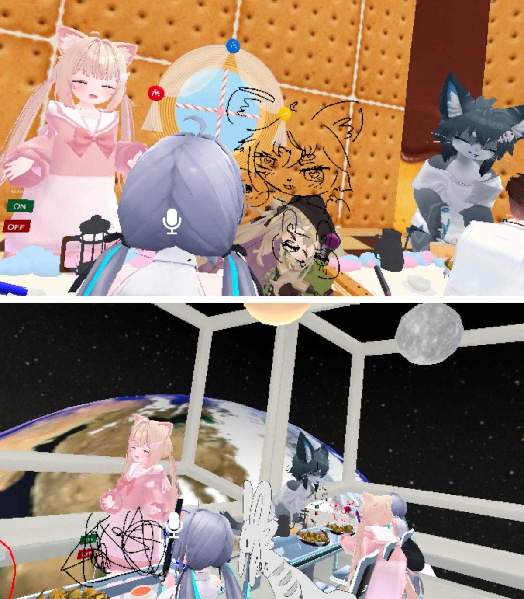
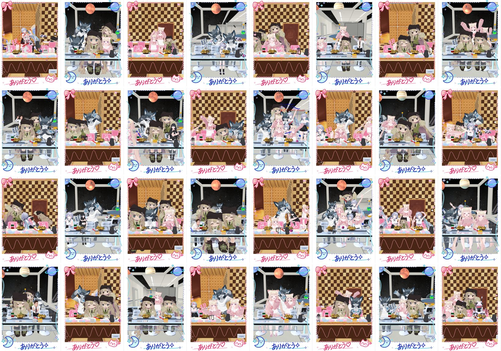
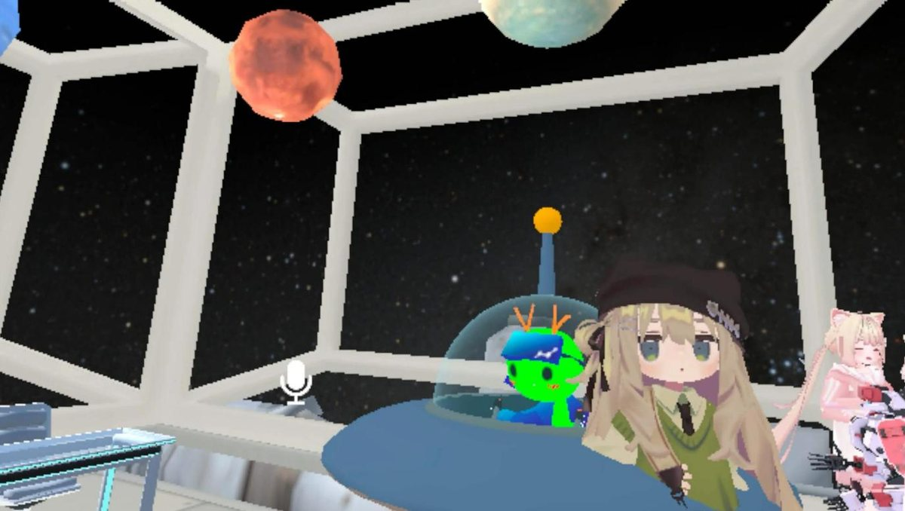
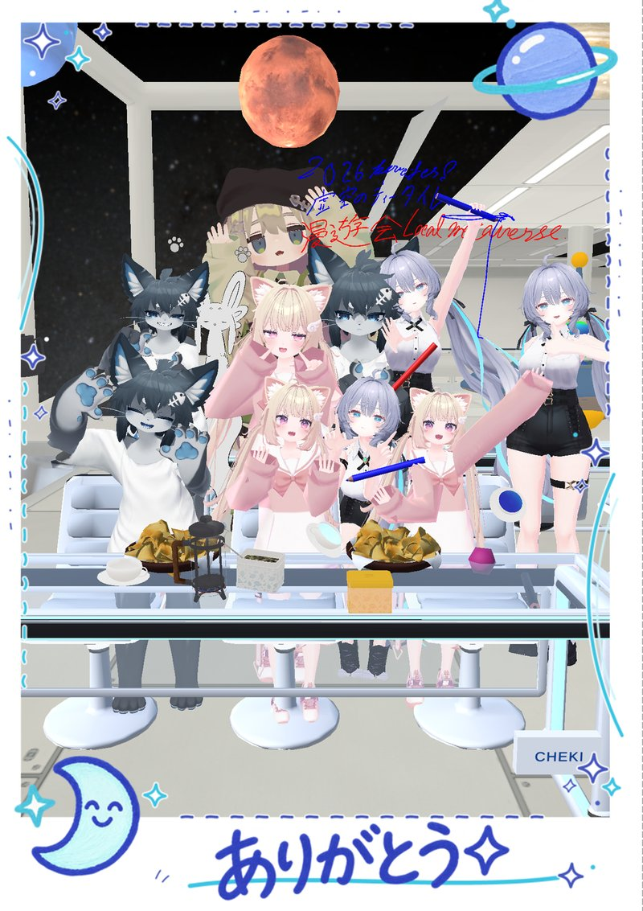

2026年11月21日（土）〜23日（月・祝）、UT-virtual VRChat漫遊会は、東京大学の駒場祭でVRカフェ「虚空のティータイム」を出展しました。
NUMAで「一緒にやりませんか？」と声をかけたら、全国の大学から仲間が集まってくれて、みんなでわちゃわちゃ接客。来てくれたお客さんは300人近くにもなり、夜は毎晩みんなでご飯を食べるなど、とにかく楽しい～～～3日間でした！

こんにちは、UT-virtualのクウナです。
この記事では、NUMA（全日本大学メタバース連盟）でつながった全国の大学のVRサークルの仲間と、一つの文化祭を駆け抜けた3日間を振り返ります。
企画の中身から、当日のドタバタ、毎晩のご飯の時間まで、当日の写真と合わせてお届けします。

## 企画概要

| 項目           | 内容                                           |
| -------------- | ---------------------------------------------- |
| 企画名         | 虚空のティータイム                             |
| 日時           | 2026年11月21日（土）〜23日（月・祝）           |
| 会場           | 東京大学 駒場キャンパス（駒場祭）              |
| 主催           | UT-virtual VRChat漫遊会                        |
| キャスト       | UT-virtual部員 ＋ NUMAから参加してくれた助っ人 |
| 来てくれた人数 | 300人近く                                      |

---

## 「虚空のティータイム」ってどんな企画？

一言で言うと、**教室が丸ごとメタバースになるカフェ**です。

1. 受付でVRゴーグル（Meta Quest）をかぶる
2. 現実の席に座る（教室をそのままVRにしているので、VRの中でも同じ席に座っている）
3. アバター姿のキャストが卓まで来て、**生の声で**おもてなし
4. VRの中で撮った写真を、**チェキにしてお持ち帰り**

VRの中は「ふわぽわ」と「宇宙」の2つの世界。お菓子でできた部屋でお茶をしたり、地球を眺めながらお茶をしたりできます。

当日のVRの中の様子（上：ふわぽわ、下：宇宙）
 

目の前のアバターに話しかけると、返事は現実の隣にいる人の口から聞こえてくる。
この不思議な感覚を、ゴーグルをかぶったことがない人にも味わってほしくて作った企画です。

キャストやお客さんが使うアバターは、**制作者の方からも許可をいただき、使わせていただくことができました！** 本当にありがとうございました。

---

## NUMAで「一緒にやろう！」と声をかけた

3日間、十数台のゴーグルを回すには、とにかく人手が必要です。
そこで10月末、NUMAのDiscordに「文化祭アテンド募集」のスレッドを立てました。

人手がほしかったのはもちろんですが、**NUMAの人たちやUT-virtualの部員と、わちゃわちゃできる機会にもしたい**、というのが正直な気持ちでした。

他大学の文化祭のために週末を使って来てくれる人なんているのかな……と不安だったのですが、すぐにいろんな大学のメンバーが手を挙げてくれました。\
🐱「RP系イベントですが、キャスト経験アリです！」\
🐶「VRChatでの接客経験はほとんど無いけど、とても興味があります」

今回一緒に走ってくれたのは、こちらのみなさんです（敬称略）。

| 所属                     | メンバー                                                                       |
| ------------------------ | ------------------------------------------------------------------------------ |
| NUMAからの助っ人キャスト | とば、wing、keitaAK、緑谷てとら、ペンギン、すかろふ、ぐっち/もえか、そうにゃん |
| UT-virtual               | クウナ、マザラン、ゆげーん、らと、わよわな、ツハ”メ、べこ |

---

## 3日間の記録

### DAY1：はじめまして、の初日

朝10時、駒場東大前の駅に集合。オンラインでしか話したことのなかった人と、ここで初めて顔を合わせます。

……が、正直に言うと準備がギリギリまで終わっておらず、初日は教室で調整をしながらのバタバタのスタートになりました💦
それでも助っ人のみなさんは、ゴーグルをかぶってお客さん役をやってみたり、キャストの練習をしてみたり、嫌な顔一つせずワイワイ付き合ってくれました。

夜は、NUMAの代表の落雁さんも一緒に、渋谷のサイゼでご飯🍝
初日にして、もうすっかり打ち解けていました。

### DAY2：大盛況の2日目

朝9時集合。開店直前には「ペンがつかめない！」なんてトラブルもありましたが、なんとか間に合って開店です。

そこからはとにかくお客さんが途切れず、一番混んだ時間には**1時間で50人ほど**をご案内しました。
「2日目の回転率ハンパなかった」という声が出るくらいで、受付、ゴーグルの装着サポート、VRの中での接客、チェキの印刷とカットまで、UT-virtualとNUMAのメンバーが混ざってぐるぐる回していました。

### DAY3：最終日

2日目でみんなすっかり慣れて、最終日はチームの動きもばっちり。
英語を話すお客さんや小さな子ども、元気なおばあさんまで、本当にいろんな方が来てくれましたが、キャストのみんなは手慣れた様子で、それぞれに合わせてメタバースの面白さを伝えていました。
友達を連れて遊びに来てくれたメンバーもいて、「他校の文化祭に行くのは人生初」という声も聞けました。

3日間で来てくれたお客さんは、**300人近く**。
それだけたくさんの人が、VRの中の卓に座ってくれました。

当日撮ったチェキの一部
 

遠方組の帰りの電車もあり、全員そろって最後まで……とはいきませんでしたが、3日間、本当にみんなで走り切りました。

---

## 夜は、毎晩みんなでご飯

今回一番「NUMAっぽいな」と思ったのは、実は営業が終わった後の時間かもしれません。

3日間、夜は毎晩みんなでご飯に行きました。
大学も学年も、住んでいる場所もばらばらのメンバーが、一つのテーブルを囲みます。

最初はお互いのサークルの話から。普段どんなイベントをしているのか、新入生をどうやって集めているのか、部室や機材はどうしているのか。同じVRサークルでも、大学が変わるとやっていることも悩みもまるで違って、聞くたびに「うちでもやってみたい」が増えていきました。
話が進むと、だんだんVRChatの話に。最近話題のあのアバターのことや、行ってみてよかったおすすめのワールドのことなど、普段メタバースで遊んでいる人たちならではの話で盛り上がりました。
そこから、それぞれがメタバースをどう見ているのか、という話にもなりました。メタバースのどこが好きなのか、これからどうなっていくと思うのか。同じ「メタバースが好き」でも見ている方向は人によって本当にばらばらで、だからこそ聞いていて面白く、気づけばいつも時間が足りませんでした。

そしてここで、全員が口をそろえた反省が一つ。

**「名刺、持ってくればよかった」**

他大学の人とこんなに話す機会があるなら、名刺はあったほうがいいです。次は絶対作ります。

---

## やってみて思ったこと

宇宙の世界で、UFOと一緒にお出迎え
 

### 初めての人の「すごい！」が、一番嬉しい

一番印象に残っているのは、**初めてVRを体験して、目を輝かせているお客さん**がたくさんいたことです。
「感動した」とわざわざ伝えに来てくれた方もいて、こちらまで胸がいっぱいになりました。
自分もアバター姿でお客さんとお話しできて、めちゃくちゃ楽しかったです。

### リアルの関係と、メタバースの関係の間で

今回の企画は、東大VRセンターのプロジェクトのもとで行った、**現実の空間を伴ったメタバース体験**です。
VRの中の教室は、現実の教室とぴったり重なっています。

だから、ちょっと不思議なことが起きます。
ついさっきまで現実で、その場で普通に話していた友達や仲間が、ゴーグルをかぶった瞬間にアバターの姿になって、メタバースの中で「キャスト」と「お客さん」として向き合う。
ゴーグルを外すと、またいつもの関係に戻る。

リアルでの関係と、メタバースの中での関係。その間を、ふわふわと行ったり来たりしているような感覚がずっとありました。
画面の中だけで完結しない、現実とつながったメタバースだからこそ味わえる感覚だったと思います。

### NUMAっていい場所だ

普段はオンラインでしか会わない、他大学の人たち。
そんなメンバーと、同じ教室で、同じゴーグルをかぶって、一つの企画を作る。
大学の垣根を越えて「一緒に何かをやる」経験は、思っていた以上に楽しくて、思っていた以上に刺激的でした。

メンバーからも、こんな声をもらいました。\
😆「忙しくするのが一番おもろい。NUMAからのキャストの人も、おもろい人たちでよかった」\
🎓「思ったより規模が大きかったし、いろんな人と面白い話もできて、とても有意義だった」\
😆「おもろすぎるから、またどっかで喋りたいな」

---

## 学祭でVR企画をやりたい人へ

まず、VRやメタバースのサークルに入っている大学生のみなさん。
**ぜひNUMAに入ってください！** 今回のように、一つのサークルだけではできないことも、NUMAでつながればできるようになります。

そのうえで、今回やってみて「これは良かった」と思ったことを3つだけ。

- **NUMAで早めに声をかける**\
  1か月前にスレッドを立てて、来られる日をリアクションで集めるだけでも、シフトがぐっと組みやすくなります。
- **夜ご飯の時間を取っておく**\
  一番仲良くなれるのは、多分ここです。
  営業中はどうしても忙しくて、ゆっくり話す時間はほとんどありません。だからこそ、営業が終わった後にみんなで同じテーブルを囲む時間が大事でした。
  それぞれのサークルの話や、メタバースへの考えを聞いているうちに、「次はこれを一緒にやりたい」というアイデアもたくさん出てきます。
  企画の時間だけでなく、ご飯の時間まで含めて計画しておくのがおすすめです。
- **それぞれの得意分野が活きる分担にする**\
  思っていたよりも、大学生は尖っています。
  特にNUMAの人たちは、全員が「好き」への情熱をいろんな方向に持っています。裏方の段取りが得意な人、ちょっとした話で場を和ませるのがうまい人、VRChatについて熱く語れる人……。
  その情熱をそのまま活かせる役割をお願いしたら、企画がとっても楽しくなりました。

---

## おわりに

「虚空のティータイム」は、たくさんの人の力を借りて成り立った企画でした。

特に、NUMAの呼びかけで集まってくれた助っ人のみなさん。
初日のバタバタから最終日まで、本当にありがとうございました。
みなさんがいなかったら、3日間を走り切ることはできませんでした。

全国の大学から集まった学生と、一つの文化祭を一緒に駆け抜ける。
昼はアバター姿でお客さんを迎えて、夜はみんなでご飯を食べながら語り合う。
書いていて自分でも思いますが、青春すぎます。本当に、他では得られないとてもいい経験になりました。
そして、こんな場を用意してくれたNUMAに、心から感謝しています。

**次は、みなさんの企画やイベントを、ぜひ私たちに手伝わせてください！** 呼ばれたら、全国どこへでも飛んでいきます。
今回のように、それぞれのサークルがNUMAを拠点にどんどんつながっていけたら、こんなに嬉しいことはありません。

それにしても、NUMAの人たちは本当に尖っていて、本当に面白かったです。
一人一人が自分の「好き」をまっすぐ持っていて、話すたびに新しい発見がありました。

**NUMA、さいこ～～！！**

最終日の最後に、みんなで撮った1枚。全員が現地でVRゴーグルをかぶって撮っていて、現実の世界でも、みんな同じ教室の同じ場所に集まっています
 

## 関連URL

- **UT-virtual**: https://utvirtual.tech/
- **NUMA 全日本大学メタバース連盟**: https://numa-meta.com/

著者：クウナ（UT-virtual）
