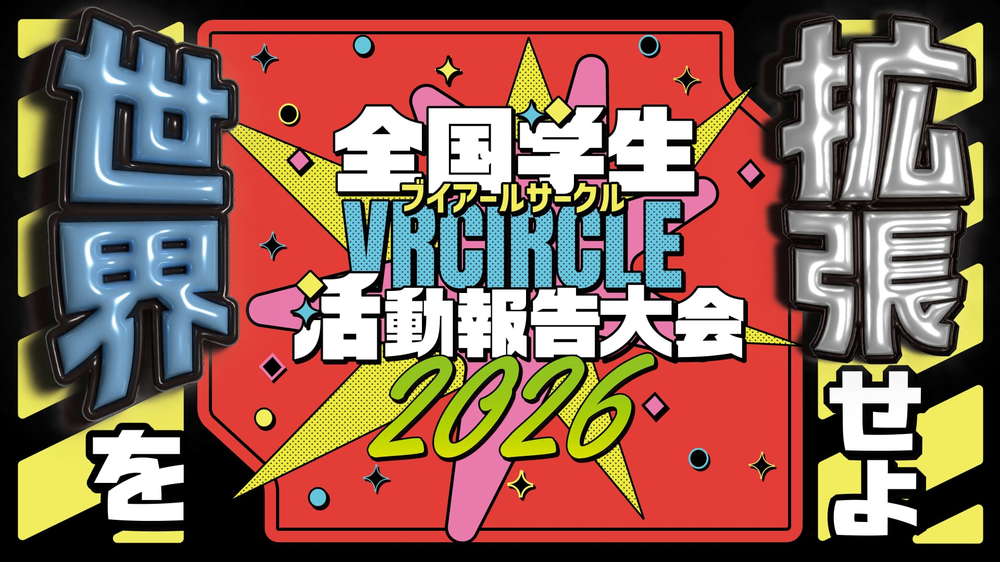
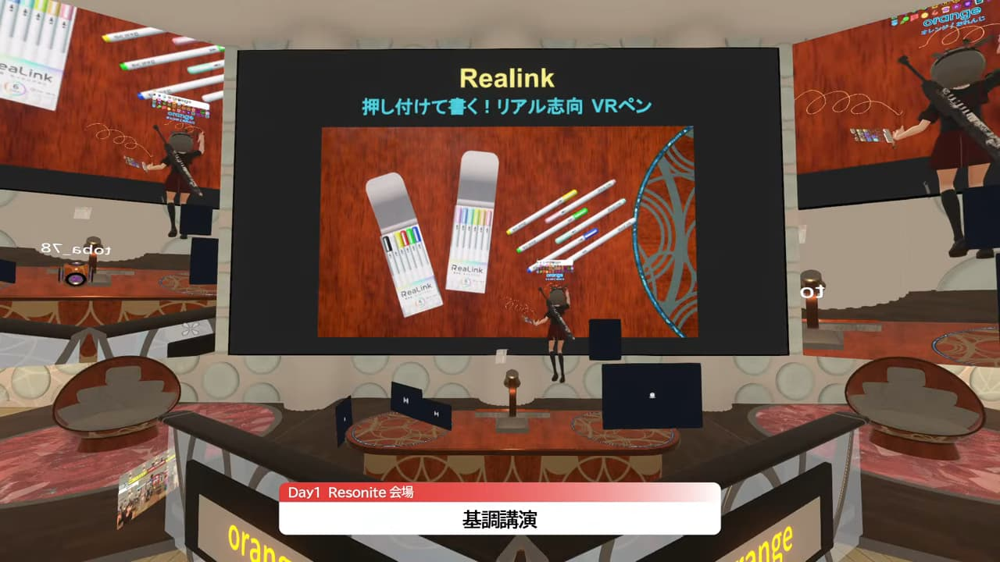
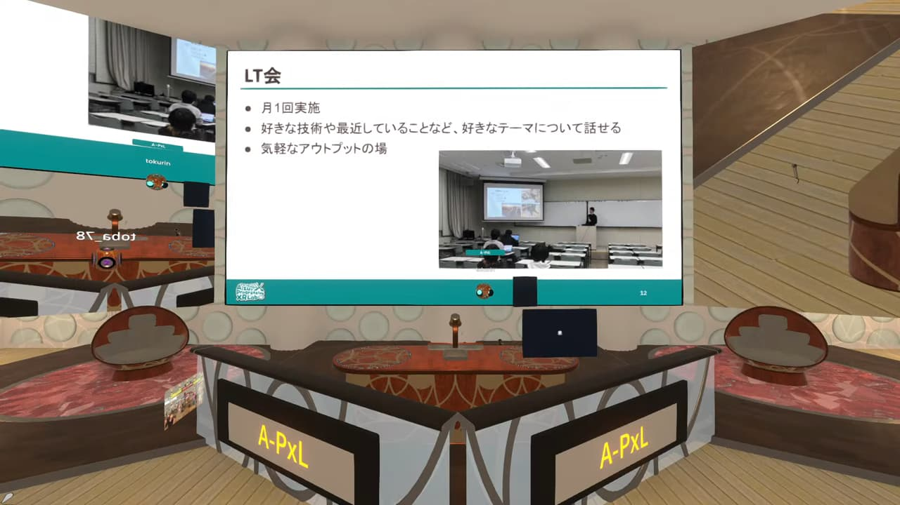
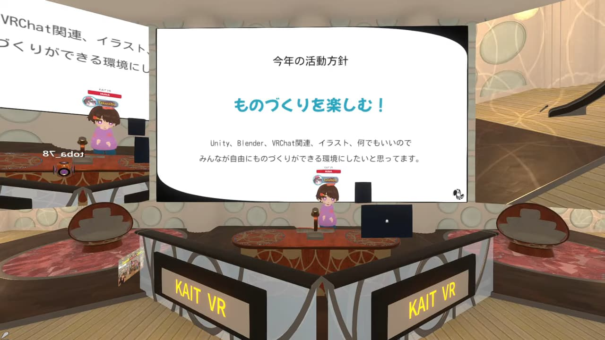
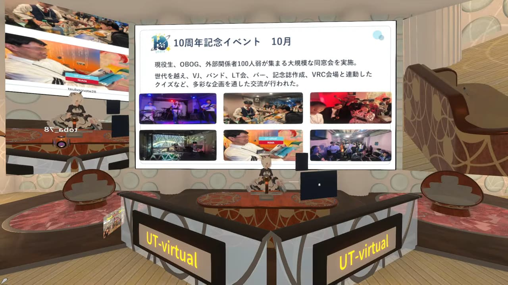
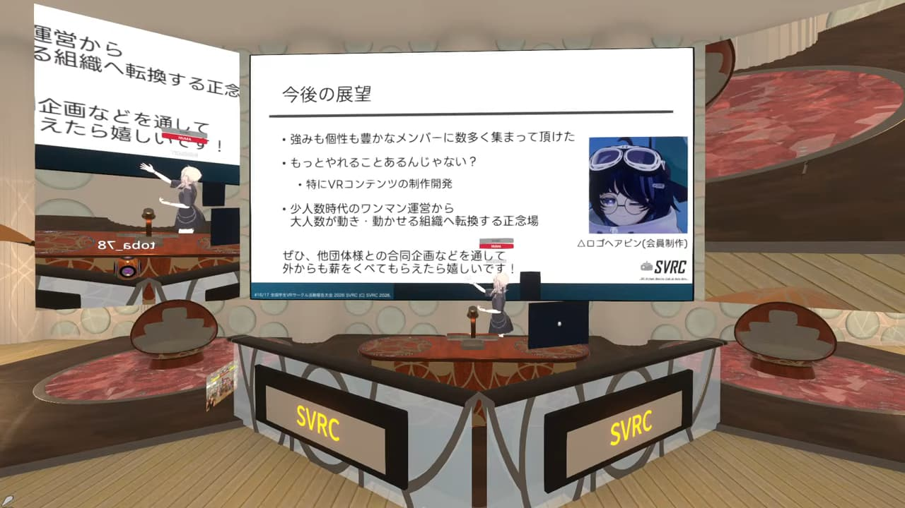
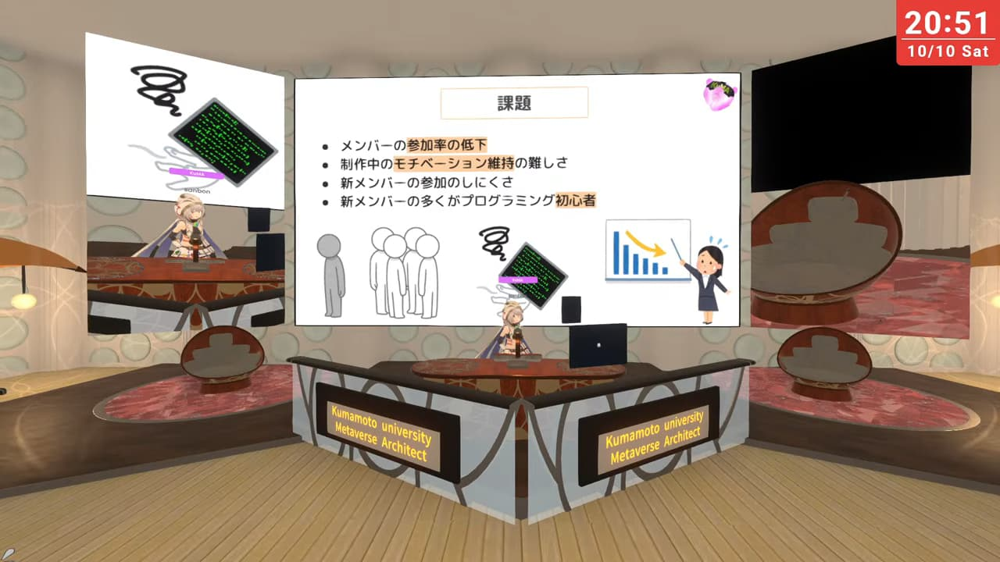
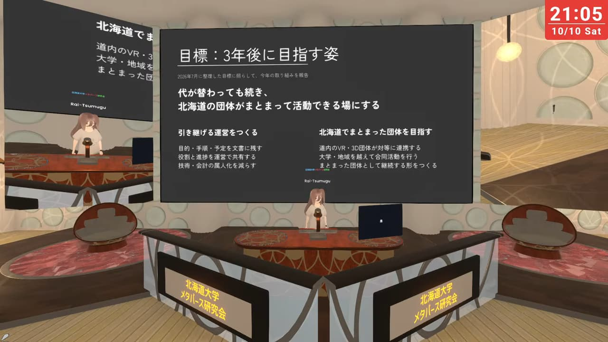
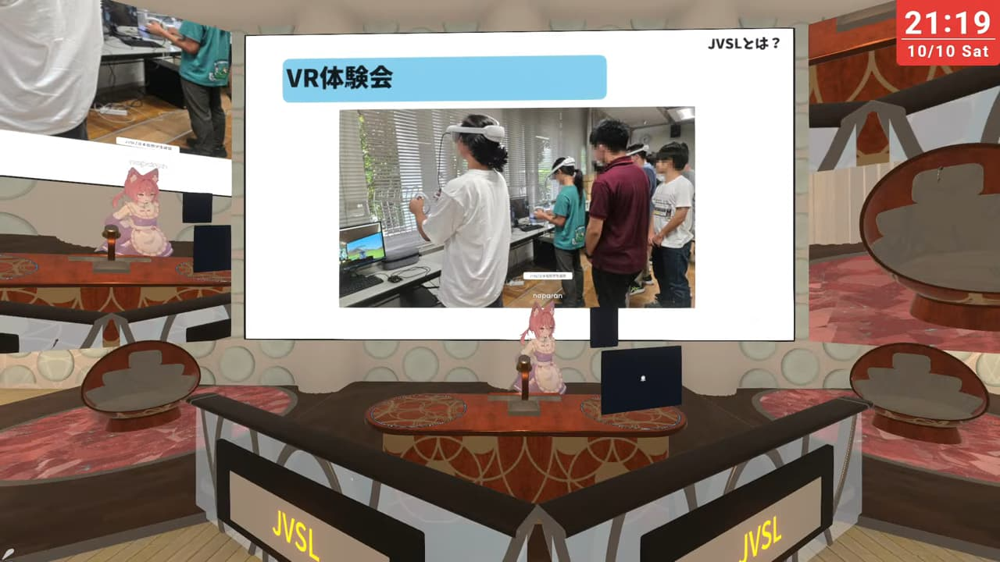

NUMA 全日本大学メタバース連盟は、2026年10月10・11日に**全国学生VRサークル活動報告大会 & XR制作物プレゼン2026**を共催しました。今年は昨年とは異なりResonite・VRChatでの開催となり、2日間にわたり14団体が登壇し、14件の制作物が発表されました。本イベントに関する詳細な情報は、特設HPをご覧ください。  

**全国学生VRサークル活動報告大会 & XR制作物プレゼン2026 特設HP**  
https://vrsc-2026.numa-meta.com/

DAY2 VRChat会場には、当日の様子を記録した**VR180の立体視映像**がアーカイブとして配置されています。ぜひHMDを装着して訪れてみてください。
https://vrchat.com/home/world/wrld_a1d1624e-c26d-47d2-b19a-019acf016e9d/info 

 

## 全国学生VRサークル活動報告大会とは
全国学生VRサークル活動報告大会とは、**全国の学生VRサークルが一堂に会し、1年間の活動報告・他団体との交流を行うイベント**です。**Day1はResonite、Day2はVRChatで開催されました。**

## DAY1の様子
### 開会式
DAY1のはじめに開会式が執り行われ、本大会の企画・運営を中心的に行ってきた[**まるまさ**](https://x.com/MarumasaVR)による開会宣言が行われました。

### 基調講演 (オレンジ)
ピピピ技研のオレンジさんにより、冒頭からResoniteの魅力がふんだんに盛り込まれた基調講演「お楽しみが2倍!!🤩 "触って楽しいVR"の作り方」が行われました。

### 登壇団体
DAY1に登壇したのは次の団体です。

A-PxL（会津大学）
 

KAIT VR（神奈川工科大学）
 

UT-virtual（東京大学）
 

SVRC（慶応義塾大学）
 

KuMA（熊本大学）
 

北海道大学メタバース研究会（北海道科学大学）
 

JVSL（インカレ）
 

DAY1だけでなく、DAY2のイベントの様子も知りたい！という方は、UT-virtualの開催報告記事や、YouTube Liveのアーカイブがありますので、そちらをぜひご覧ください。  
**DAY1**: https://www.youtube.com/watch?v=Oaqvx7YCu0c  
**DAY2**: https://www.youtube.com/watch?v=nz3gcGCO-Fg  

### XR制作物プレゼン
その後、XR制作物プレゼンは次の題目で行われました。

- ハートキャッチゆびから / team04
- 融合3次元画像を利用した遠隔手術指導(Telementoring)のシステム構築 / 佐野隼乙
- VRでの疑似摂食行為が食欲抑制に与える影響 / たいせい
- Haptics powered armor / Beginners Hero
- the Last Light on Luna / 月うさぎ
- Storytelling from Objects / gg13

## Resoniteについて

今年採用した**Resonite**は、VRChatほど知名度があるわけではありませんが、**自由度が比較的高い**VRSNSとして知られています。例えば、VRChatではスライド発表のための資料を一度動画に変換する必要がありますが、ResoniteではPCに保存されているpdfや動画、3Dオブジェクトをそのまま持っていくことができます。

今年は、そのような自由度の高いプラットフォームを登壇・プレゼンを行う環境として、実験的に用いることとしました。

(resonite pic)

## NUMAの今後のイベントについて
次の大型イベントは、来年3月頃に開催予定のV化祭2027を予定しています。

ぜひ、YouTubeのアーカイブもご覧いただき、次回のイベントにもご参加ください！

## 関連URL
**全国学生VRサークル活動報告大会 & XR制作物プレゼン2026**  
**特設HP**: https://vrsc-2026.numa-meta.com/  
**VRChat Group**: https://vrchat.com/home/group/grp_ef29c6cc-6df9-4600-a9d8-b8956e5cb41c  

**DAY1 in Resonite**  
**YouTube**: https://www.youtube.com/watch?v=Oaqvx7YCu0c  
**Resonite**: URL

**DAY2 in VRChat**  
**YouTube**: https://www.youtube.com/watch?v=nz3gcGCO-Fg  
**VRChat**: https://vrchat.com/home/world/wrld_a1d1624e-c26d-47d2-b19a-019acf016e9d/info  

**UT-virtual**  
https://utvirtual.tech/

**NUMA 全日本大学メタバース連盟**  
https://numa-meta.com/